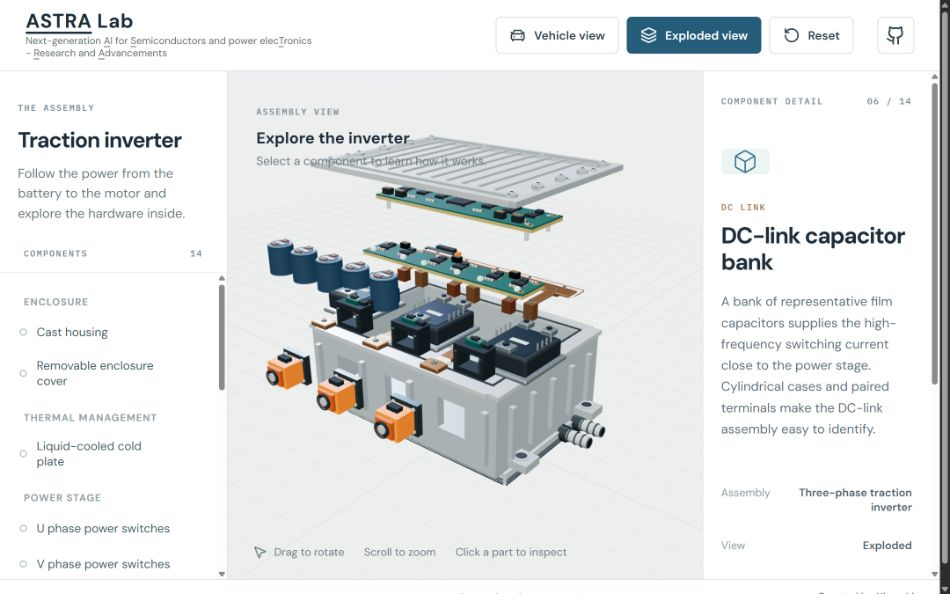

# Explore an Electric Vehicle Traction Inverter in 3D


<!-- clone-stats:start -->
<p align="center">
  <a href="https://github.com/XinzeLee/traction-inverter-explorer/graphs/traffic">
    
  </a>
  <a href="https://github.com/XinzeLee/traction-inverter-explorer/graphs/traffic">
    
  </a>
</p>

<p align="center"><sub>GitHub traffic (monitoring started on November 24, 2026) · cumulative tracked clones · Till 2026-11-24 UTC</sub></p>
<!-- clone-stats:end -->

Explore how a traction inverter fits into a battery electric vehicle and how its power-electronics hardware is assembled. This interactive model connects the inverter’s internal components to the surrounding vehicle power system.

## Explore the 3D model

<a href="https://xinzelee.github.io/traction-inverter-explorer/"></a>

[](https://xinzelee.github.io/traction-inverter-explorer/)

Rotate and zoom the conceptual three-phase traction inverter, select components, and switch between assembled and exploded views. Isolate the DC-link capacitors, busbars, power modules, gate drivers, control board, current sensors, connections, enclosure, and liquid-cooled cold plate to learn their roles.

## Explore the vehicle power system

Select **Vehicle view** to see the inverter and motor alongside the high-voltage battery, battery management system, power junction, auxiliary loads, and charging equipment. Select a numbered component to inspect it and its connected components. Colored paths distinguish high-voltage DC, motor AC, charging, control signals, and wireless coupling.

Wired AC, external DC fast charging, and wireless charging are shown together as alternative charging paths. Component placement and cable routing are illustrative. The model combines features from several reference designs; it is not a dimensioned CAD model or a validated production inverter.

## Run locally

Install Node.js 22.12 or later, open a terminal in the project directory, and run:

```sh
npm ci
npm run dev -- --port 4174
```

Open the address printed in the terminal, usually [http://127.0.0.1:4174/](http://127.0.0.1:4174/). Drag to orbit, scroll to zoom, and click a component or use the list to learn about it. A browser with WebGL support is needed.

For development checks, run `npm test` and `npm run build`.

## Sources and further reading

- [TI TIDM-02014 traction inverter reference design](https://www.ti.com/lit/ug/tiduf23/tiduf23.pdf)
- [Wolfspeed CAB450M12XM3 half-bridge module](https://assets.wolfspeed.com/uploads/2024/01/Wolfspeed_CAB450M12XM3_data_sheet.pdf)
- [KEMET C4DE DC-link film capacitors](https://content.kemet.com/datasheets/KEM_F3059_C4DE.pdf) — a cylindrical-package form reference; no automotive qualification or specific rating is implied for the model.
- [NXP EV inverter reference platform](https://www.nxp.com/document/guide/getting-started-with-the-ev-invertergen3-ev-traction-inverter-control-reference-design-gen-3:GS-EV-INVERTERGEN3), [Infineon inverter evaluation kit](https://www.infineon.com/assets/row/public/documents/10/42/infineon-an-g2-kitquickstart-applicationnotes-en.pdf), and [LEM HAH3 current sensor](https://www.lem.com/en/hah3)
- [TI onboard and DC-fast charging overview](https://www.ti.com/document-viewer/lit/html/SSZTA03/GUID-914A2889-092F-4218-8E24-16A295783CEF) and [U.S. DOE wireless charging research](https://www.energy.gov/sites/default/files/2024-11/VTO_2023_APR_ELECTRIFICATION%20REPORT_compliant_.pdf)

Created by **[Xinze Li](https://github.com/XinzeLee)**. The project does not currently include a license file; linked reference materials have their own terms.
